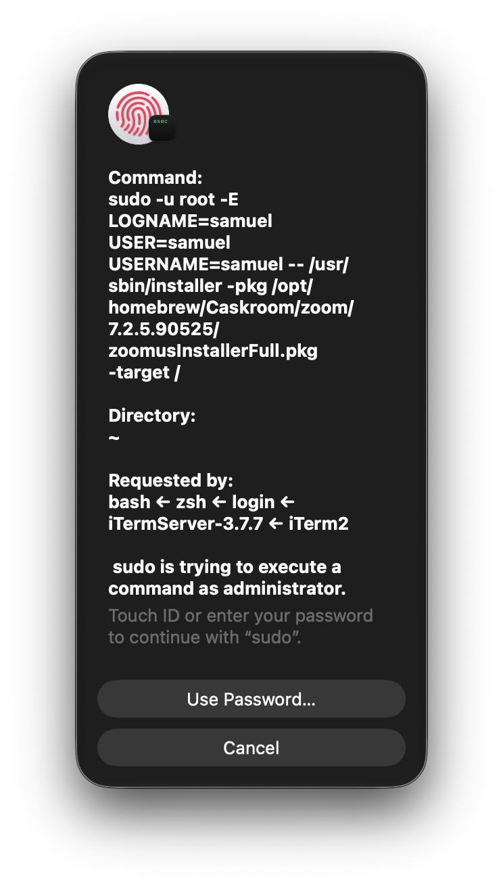

# pam_tid_look

*Look before you touch.*

Touch ID for `sudo` on macOS, like Apple's `pam_tid.so`, with one difference:
the dialog shows what you are approving.

<p align="center">
  
</p>

Authentication is left to Apple, exactly as `pam_tid.so` does it. The module
only adds the text. Why it is built this way is in [DESIGN.md](DESIGN.md).

Requires macOS 14 (Sonoma) or later.

[macos-sudo-touchid-context](https://github.com/laurigates/macos-sudo-touchid-context)
also shows the command, but checks the fingerprint itself with
LocalAuthentication. pam_tid_look leaves that decision to Apple's own sudo
request, and adds the PATH lookup, a dialog timeout, and an installer that
undoes its change if sudo would break.

- [Install](#install)
- [Update](#update)
- [Uninstall](#uninstall)
- [Break glass](#break-glass): when sudo stops working
- [Development](#development)
- [License](#license)

## Install

With Homebrew:

```
brew install samuelb/tap/pam_tid_look
sudo "$(brew --prefix)/bin/pam_tid_look" install
```

Homebrew may first ask you to trust the tap (`brew trust`). `brew install` only
puts the files in Homebrew's prefix. The second command is what changes sudo.

To build and install it from the source instead, see
[DEVELOPMENT.md](DEVELOPMENT.md#build-and-install-from-the-source).

The first time, macOS asks whether your terminal app may administer the
computer. Allow it: only then may root change `/etc/pam.d`.

### What install does

`install` copies the module to `/Library/Security/pam_tid_look`, which only
root can change, and puts it in `/etc/pam.d/sudo_local` in place of the
`pam_tid.so` line.

Before it changes anything, it checks that:

- sudo starts,
- sudo asks you to authenticate for `/usr/bin/true`. With a `NOPASSWD` rule
  for it, install refuses, because Touch ID could not be tested,
- PAM can load the module and the new config.

Then it shows the change to `sudo_local` as a diff, the module's SHA-256 hash
and whether it differs from the one installed, and asks you to confirm.

Afterwards it checks that sudo still starts, and opens a Touch ID dialog for
`sudo -S -k /usr/bin/true`, which you approve.

Everything is put back as it was if a check fails, if you cancel the dialog or
leave it for two minutes, or if the run is interrupted.

### Options

`--yes` answers the confirmation in advance, for scripts. The question is
asked on the terminal, so without a terminal and without `--yes`, install
changes nothing.

`--timeout SECONDS` sets how long the dialog waits for a fingerprint before it
closes and sudo asks for the password: 0 to 3600, where 0 means no limit. The
default is 0. A reinstall keeps the current value. Install always writes the
value on the module's line in `sudo_local`, as `timeout=SECONDS`, so it can be
changed there.

The `sudo_local` that install replaces is kept in `/etc/pam.d` (see
[Backups](#backups)).

### Status

To see what is installed, without sudo:

```
pam_tid_look status
```

## Update

```
brew upgrade pam_tid_look
sudo "$(brew --prefix)/bin/pam_tid_look" install
```

`brew upgrade` only replaces the files in Homebrew's prefix. Until install runs
again, sudo keeps the module it has.

## Uninstall

```
sudo "$(brew --prefix)/bin/pam_tid_look" uninstall
brew uninstall pam_tid_look
```

If Homebrew's copy is already gone, the installed copy does the same:

```
sudo /Library/Security/pam_tid_look/pam_tid_look uninstall
```

`uninstall` shows the change to `sudo_local` and asks before it makes it, the
same way install does, `--yes` included. Then it puts the `pam_tid.so` line
back and checks that sudo starts. If sudo does not start, and did not start
before either, it moves `sudo_local` aside, so that sudo works with the
password as on a new Mac, and says where the rest of the file went. The
`sudo_local` it replaces is kept as a backup.

## Break glass

If sudo stops working because of this module, for example after a macOS
update, you cannot use sudo to remove it. You would see
`sudo: unable to initialize PAM: system error`, or sudo crashing or hanging.

None of the ways back below use sudo. Try them in this order.

### 1. `rescue`

In Terminal, without sudo:

```
/Library/Security/pam_tid_look/pam_tid_look rescue
```

`pam_tid_look rescue` from Homebrew does the same.

It asks for an administrator password in a macOS dialog, which does not go
through sudo, and replaces the module with Apple's own `pam_tid.so`. sudo then
works with Apple's Touch ID, without the command in the dialog. Then remove
pam_tid_look, or install a working build:

```
sudo pam_tid_look uninstall
```

The rescue does not edit `/etc/pam.d/sudo_local`: macOS does not let a process
started from that dialog change `/etc/pam.d`, even as root.

If sudo starts but crashes or hangs while it authenticates you, `rescue` finds
nothing wrong, because it checks sudo as root and root is not asked to
authenticate. In that case, run `rescue --force`: it replaces the module even
though sudo starts.

### 2. One line of AppleScript

If pam_tid_look's files are gone too, this puts a copy of Apple's module where
`sudo_local` expects this one:

```
osascript -e 'do shell script "mkdir -p /Library/Security/pam_tid_look && cp /usr/lib/pam/pam_tid.so.2 /Library/Security/pam_tid_look/.new && mv -f /Library/Security/pam_tid_look/.new /Library/Security/pam_tid_look/pam_tid_look.so" with administrator privileges'
```

Then, with sudo working, take the line out and remove the files:

```
sudo sed -i '' -e '/pam_tid_look[.]so/d' -e 's/^#pam_tid_look# //' /etc/pam.d/sudo_local
sudo rm -r /Library/Security/pam_tid_look
```

### 3. Without a GUI session

Over ssh, for example, there is no dialog. Give root a password with
`dsenableroot`, which asks for yours and does not use sudo, then:

```
su -
/Library/Security/pam_tid_look/pam_tid_look rescue
exit
dsenableroot -d
```

The last line turns root off again. This way has not been tested.

### 4. macOS Recovery

If nothing else works:

1. Start up in Recovery. On Apple silicon, shut down, hold the power button
   until the options appear, and choose Options. On Intel, hold Command-R
   while starting up.
2. If FileVault is on, open Disk Utility, select the Data volume and click
   Mount.
3. Choose Utilities > Terminal and run the following, with the Data volume's
   name as `ls /Volumes` shows it:

   ```
   mv "/Volumes/Macintosh HD - Data/private/etc/pam.d/sudo_local" "/Volumes/Macintosh HD - Data/private/etc/pam.d/sudo_local.disabled"
   ```

4. Restart. sudo then works with the password only.

To get Touch ID back, write the file back without this module's line:

```
sudo sh -c 'sed -e "/pam_tid_look[.]so/d" -e "s/^#pam_tid_look# //" /etc/pam.d/sudo_local.disabled > /etc/pam.d/sudo_local'
sudo rm -r /Library/Security/pam_tid_look
```

### Backups

Install and uninstall keep the `sudo_local` they replace as hidden files next
to it, named by date and time. The newest five are kept:

```
ls -l /etc/pam.d/.sudo_local.pam_tid_look-backup.*
```

A backup taken while pam_tid_look was installed names its module. If you put
such a backup back after the module is gone, sudo no longer starts. To list
the backups that do not name it:

```
grep -L pam_tid_look.so /etc/pam.d/.sudo_local.pam_tid_look-backup.*
```

`rescue` cannot put a backup back: macOS does not let a process started from
its dialog change `/etc/pam.d`. With sudo working, for example after a rescue,
copy it back with the name `ls` shows:

```
sudo cp /etc/pam.d/.sudo_local.pam_tid_look-backup.20261114-101500 /etc/pam.d/sudo_local
```

Without sudo, macOS Recovery can do it, as in [way 4](#4-macos-recovery), with
the Data volume's path in place of `/etc`:

```
cp "/Volumes/Macintosh HD - Data/private/etc/pam.d/.sudo_local.pam_tid_look-backup.20261114-101500" "/Volumes/Macintosh HD - Data/private/etc/pam.d/sudo_local"
```

A root shell from `su`, as in [way 3](#3-without-a-gui-session), may be able
to as well; that has not been tested.

## Development

Building and installing from the source, testing and releasing are described
in [DEVELOPMENT.md](DEVELOPMENT.md).

## License

MIT, see [LICENSE](LICENSE). Parts of the code and of the CI workflow follow
[macos-sudo-touchid-context](https://github.com/laurigates/macos-sudo-touchid-context)
(MIT, © 2026 Lauri Gates) and are marked in the source.
